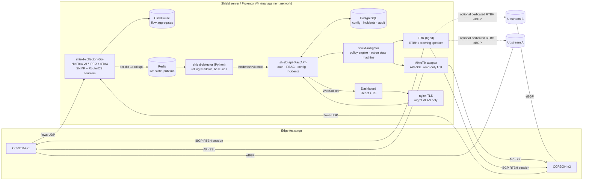
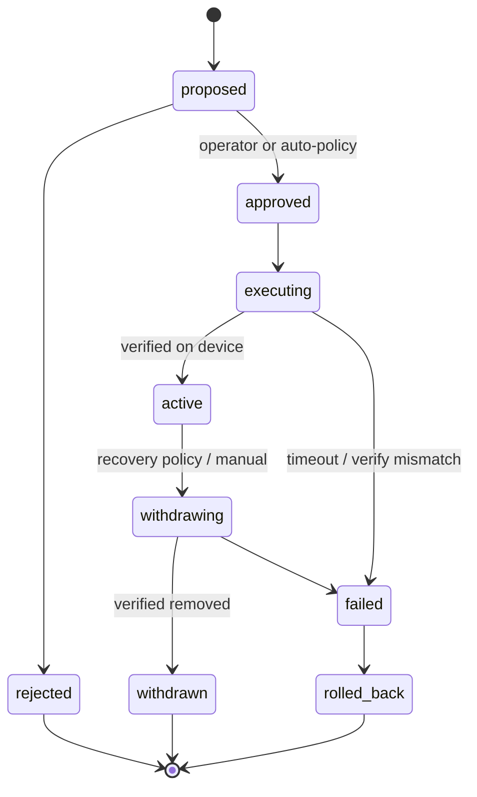

# System Architecture

## 1. Goals and non-goals

**Goals**

- Detect volumetric and protocol DDoS attacks against protected destinations within seconds,
  using flow telemetry (NetFlow v9 / IPFIX / sFlow) plus SNMP/RouterOS counters.
- Contain attacks with the least destructive mitigation that the operator's policy allows:
  local filtering → scrubbing (if present) → selective upstream steering → RTBH.
- Make every network-changing action explicit, authorised, idempotent, verifiable, reversible and audited.
- Run entirely on-premises with no mandatory cloud dependency.

**Non-goals / physical limits**

- The platform does not add capacity. If an attack saturates an upstream link, nothing
  done on our side of that link restores it; only upstream action (RTBH at the provider,
  upstream filtering, or diversion to a scrubbing provider) helps. The UI says this
  explicitly whenever upstream utilisation exceeds the configured saturation level.
- RTBH discards *all* traffic to the blackholed destination. It is containment, not cleaning.

## 2. Component diagram

## 3. Components

| Service | Language | Responsibility | Phase |
|---|---|---|---|
| `shield-api` | Python / FastAPI | AuthN/Z, configuration, incidents, action approval, audit, WebSocket fan-out | 2 |
| `shield-collector` | Go | Decode NetFlow v9/IPFIX/sFlow, apply sampling rate, emit 1 s per-destination rollups to Redis and minute aggregates to ClickHouse; poll SNMP/RouterOS counters | 3 |
| `shield-detector` | Python | Rolling-window and baseline-deviation detection per destination and per prefix; vector classification; confidence scoring; suspected → confirmed state machine | 4 |
| `shield-mitigator` | Python | Policy evaluation, action planning, impact preview, approval gate, execution with idempotency keys, verification, recovery timers, flap dampening; speaker behind an interface (simulated in phase 6, FRR from phase 7) | 6–8 |
| MikroTik adapter (`shield-mikrotik`) | Python, own RouterOS API client (no third-party library) | Version-aware RouterOS v7 adapter. Read-only mode first; writes limited to Shield-owned address lists, routing filters and routes tagged with a Shield comment | 5, 8 |
| FRR | C (system pkg) | BGP speaker for RTBH and steering announcements, driven via `vtysh`/config fragments, strictly prefix-filtered | 7 |
| Dashboard | React, TS, Tailwind | 17 pages listed in the master spec; live updates over WebSocket | 3+ |

Each service is an independent systemd unit. Failure of one collector or data source
degrades the relevant panels to "unavailable" instead of stopping the system.

## 4. Data flow and measurement honesty

Every traffic figure carries a **provenance** tag that the UI renders:

| Provenance | Source | Example |
|---|---|---|
| `measured` | Exact interface counters (SNMP ifHCInOctets, RouterOS `/interface` counters) | Upstream A ingress 4.2 Gb/s |
| `sampled` | Flow records scaled by sampling rate | Dest 163.5.191.20 ≈ 1.1 Mpps (1:1024) |
| `estimated` | Derived (e.g. reflection source count, baseline forecasts) | ≈ 12 000 reflectors |
| `unavailable` | Source down/stale beyond timeout | — |

Freshness is tracked per source; values older than the source timeout become `unavailable`.

## 5. Mitigation action lifecycle

All network-changing operations go through a single state machine persisted in
PostgreSQL (`mitigation_actions`). This makes restarts safe: on startup the mitigator
reconciles every non-terminal action against the device/BGP state.

Every action has: a UUID, a client-supplied idempotency key (unique), a timeout,
expected device/BGP state, observed state after verification, and a full event history.

## 6. Safety interlocks (cross-cutting)

1. **Authorisation scope** — a target must fall inside an enabled `protected_prefixes` row
   with `rtbh_allowed`/`steering_allowed` as appropriate. Checked in the API and again in the mitigator.
2. **Scope limit** — policies carry `max_prefix_len_scope`; blackholing a /24 or /23 when the
   target is a /32 requires a policy that explicitly allows prefix-wide scope.
3. **Per-upstream RTBH policy** — community, next-hop, accepted prefix-length range, max routes.
   No defaults are assumed; an upstream with no RTBH policy cannot receive RTBH routes.
4. **Global kill switch** — `system_settings.automation_enabled=false` stops all automatic actions;
   `rtbh_emergency_disable` withdraws nothing automatically but blocks new announcements.
5. **Concurrency limits** — max concurrent actions per policy and global max RTBH routes.
6. **Flap dampening** — minimum hold time and cooldown before re-announcement.
7. **Dry-run** — every adapter supports `dry_run`, which returns the exact commands/route changes.

## 7. Storage

- **PostgreSQL** — authoritative config, users, incidents, actions, RTBH ledger, audit chain,
  config versions. Small, transactional, backed up nightly.
- **ClickHouse** — flow aggregates with TTL: 1-minute rollups 30 d, 5-minute rollups 180 d,
  raw sampled flows 48 h (configurable). Phase 3.
- **Redis** — 1-second per-destination counters, WebSocket pub/sub. Loss is tolerable.
- `flow_summaries` / `traffic_baselines` tables in PostgreSQL hold only the compact,
  per-destination statistics the detector and incident evidence need.

## 8. Redundancy

The two CCR2004s are treated as **independent** devices. Shield does not assume config sync;
each Shield-owned object is applied and verified per router, and the UI shows per-router state.
Running two Shield instances in active/standby is supported from Phase 8 via a PostgreSQL
advisory lock held by the active mitigator.
