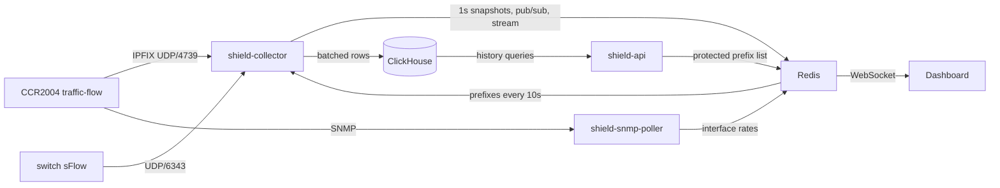

# Flow collection and live traffic (Phase 3)

Three small Go programs, no third-party dependencies:

| Binary | Purpose |
|---|---|
| `shield-collector` | Receives NetFlow v9, IPFIX and sFlow v5; aggregates per protected destination per second; publishes to Redis (live) and ClickHouse (history) |
| `shield-snmp-poller` | Reads 64-bit interface counters (IF-MIB ifXTable) over SNMPv2c: the **measured** upstream utilisation |
| `shield-flowgen` | Lab only: emits synthetic flow exports for test scenarios. Refuses non-private collectors |



## What the numbers mean

| Label | Where it comes from | Trust it for |
|---|---|---|
| **Measured** | SNMP or sFlow interface counters | Link utilisation, saturation alarms |
| **Sampled** | Flow records multiplied by the exporter's sampling rate | Per-destination rates, protocol mix. Error shrinks as rate grows: at 1:1024, a 1 Mpps flood reads within a few percent; a 2 kpps host can be off by 20–30% |
| **Estimated** | Some contributing exporter did not report its sampling rate, so its records were counted 1:1 | Nothing quantitative. Fix the exporter or set `sampling_rate` for it in `collector.json` |
| **No data** (hatched) | Source down or stale | Never read a hatched span as zero traffic |

Per-destination rates are bucketed by the second the record **arrives**. Flows longer than
`spread_threshold_ms` are spread evenly over their duration (capped at `max_spread_seconds`), so a
long-lived flow exported once per active timeout does not appear as a spike. Floods are made of short
flows and show up immediately.

Distinct-source counts use a 4096-bit linear counter: within ~2% up to a few thousand sources,
saturating around 34k. Treat "≈34k" as "very many".

## Router configuration: MikroTik RouterOS v7 (CCR2004 / CCR2116)

Command names and available parameters differ between RouterOS 7.x releases. Check each command
against `/ip traffic-flow print` on your version, and test on the secondary router first.

```routeros
# Export from the upstream-facing interfaces only.
/ip traffic-flow set enabled=yes interfaces=sfp-sfpplus1 \
    cache-entries=256k active-flow-timeout=1m inactive-flow-timeout=15s \
    packet-sampling=yes sampling-interval=1024 sampling-space=0
/ip traffic-flow target add dst-address=10.255.0.10 port=4739 version=ipfix src-address=10.255.0.1

# Read-only SNMP, reachable from the Shield host only.
/snmp community add name=<long-random-string> addresses=10.255.0.10/32 read-access=yes write-access=no
/snmp set enabled=yes
/interface print oid where name=sfp-sfpplus1      # note the ifIndex for snmp-poller.json
```

Notes:

- **Sampling.** Sampling keeps router CPU and flow volume bounded during an attack. Confirm on the
  System health page that the collector shows "1 in 1024 (from exporter)". If it shows
  "Unknown", the router is not exporting the rate. Set `"sampling_rate": 1024` for that exporter in
  `collector.json`.
- **Active timeout.** The collector spreads long flows; it cannot make data arrive sooner. Short
  timeouts give faster detection at the cost of more export packets.
- **Export source address.** Always set `src-address` to the management address listed under
  `exporters`. Packets from any other address are dropped and counted as rejected (threat model T1).
- **Two routers.** Configure export on both. The collector does not deduplicate: if the same traffic
  passes both routers' exported interfaces, it is counted twice. Export only on the edge interfaces
  each upstream enters through.

## Collector configuration

Copy `deploy/collector/collector.example.json` to `/etc/crapplet-shield/collector.json`. Key fields:

| Field | Meaning |
|---|---|
| `listen.*` | Bind to the management address, not 0.0.0.0, in production |
| `exporters` | Allow-list. Anything else is rejected. `sampling_rate` overrides what the device reports |
| `static_prefixes` | Extra prefixes besides those published by the API (normally empty) |
| `clickhouse.store_min_pps` | Destinations below this rate are not written to history (they still appear live) |
| `clickhouse.store_raw_flows` | Keep every sampled record for 48h. Useful for forensics; heavy |

Passwords come from `/etc/crapplet-shield/collector.env` (`SHIELD_REDIS_PASSWORD`,
`SHIELD_CLICKHOUSE_PASSWORD`), generated by the installer.

## Lab testing

```bash
make collector
collector/bin/shield-flowgen -list
collector/bin/shield-flowgen -format ipfix -collector 127.0.0.1:4739 -scenario syn-flood -victim 163.5.191.20
collector/bin/shield-flowgen -format sflow -collector 127.0.0.1:6343 -scenario ntp-reflect \
    -prefix 77.107.95.0/24 -victim 77.107.95.9 -sampling 4096
collector/bin/shield-flowgen -format netflow -scenario baseline -no-sampling-info   # shows "Estimated"
```

Measured during development (single VM, loopback):

| Scenario | Format, sampling | Expected victim rate | Reported |
|---|---|---|---|
| UDP flood | NetFlow v9, 1:1024 | 1,000,000 pps | 1.01–1.04 Mpps, sampled |
| SYN flood | IPFIX, 1:1024 | 800,000 pps | 800,768 pps avg, SYN 800,461 |
| NTP reflection | sFlow, 1:4096 | 400,000 pps | 379,699 pps avg, all from UDP/123 |
| Baseline, rate not exported | NetFlow v9, 1:100 | ~400 pps per host | 4 pps per host, labelled **estimated** |

## Sizing

The collector is CPU-bound on decoding: budget one core per ~150k flow records/s. Memory is about
1 KB per active destination plus spreading state. Flow volume, not traffic volume, drives load:
records/s ≈ packets/s ÷ sampling rate (for floods with randomised ports).

## Troubleshooting

| Symptom | Check |
|---|---|
| Health shows collector "not running" | `journalctl -u shield-collector`; usually a config error (it names the field) |
| Collector "running, no exporters sending" | Router export target and `src-address`; host firewall allows UDP from the router; the **Rejected packets** counter |
| Numbers labelled Estimated | Exporter sampling shows "Unknown" on System health. Set `sampling_rate` |
| **Records without template** keeps rising | Normal for a minute after a collector restart (templates are re-sent periodically); if persistent, lower the router's template refresh interval |
| **Queue drops** above zero | Collector CPU-bound. Raise sampling or give the VM more cores |
| `netstat -su` receive buffer errors | Apply `deploy/sysctl/90-shield.conf` |
| History gaps but live OK | ClickHouse down or backlogged: System health shows the last ClickHouse error |
