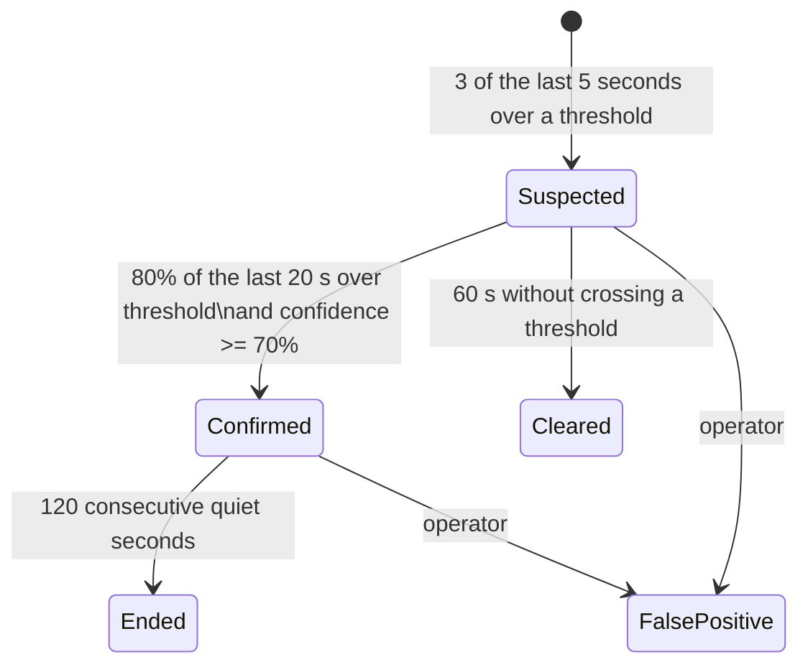

# Attack detection (Phase 4)

`shield-detector` reads the collector's one-second snapshots from Redis, decides which
destinations are under attack, and records incidents with a timeline and evidence. It never
changes the network: mitigation is a separate, approval-gated phase.

## How a decision is made



All numbers above are the defaults in a **detection profile** and can be changed per range under
**Settings, Detection thresholds**. Only *confirmed* attacks will be eligible for mitigation.

### Checks (per destination, every second)

| Attack type | Fires when (defaults) |
|---|---|
| SYN flood | SYN-only TCP ≥ 50 kpps and ≥ 50% of TCP |
| ACK / RST flood | ACK-only (≥ 60% of TCP) or RST ≥ 100 kpps |
| UDP flood | UDP ≥ 100 kpps, ≥ 60% of traffic, and not a reflection attack |
| ICMP flood | ICMP ≥ 20 kpps and ≥ 50% of traffic |
| Fragment flood | fragments ≥ 20 kpps and ≥ 30% of traffic |
| DNS, NTP, SSDP, CLDAP, memcached, chargen, SNMP, WS-Discovery, CoAP, ARD, portmap, NetBIOS reflection | ≥ 20 kpps from that UDP source port |
| High packet rate / bandwidth | ≥ 100 kpps or ≥ 1 Gb/s to one address |
| Unusual for this time | above 4x the learned normal (and ≥ 20 kpps), when a baseline exists |
| Carpet bombing | whole prefix ≥ 500 kpps or 5 Gb/s, no single address carrying most of it, after excluding addresses already detected individually |

A customer's own `pps_threshold` / `bps_threshold` (Customer IPs) override the packet and
bandwidth checks for that address.

### Confidence

```
confidence = quality x (0.30 magnitude + 0.30 specificity + 0.25 persistence + 0.15 baseline)
```

| Factor | Meaning |
|---|---|
| magnitude | how far over threshold (3x or more = full) |
| specificity | how attack-shaped: reflection 1.0, SYN 0.9, ICMP/fragments 0.85, ACK/RST 0.8, carpet 0.75, UDP 0.7, plain volume 0.5, "unusual" 0.3 |
| persistence | share of hot seconds in the confirmation window |
| baseline | distance above this address's normal for this hour of the week (0.6 when not yet learned) |
| quality | 0.7 if any flow data came from an exporter that does not report its sampling rate |

The incident page shows each factor, so an operator can see *why* Shield believes something.

### Why legitimate spikes are not confirmed

A flash crowd (lots of normal web traffic) crosses the packet threshold but matches no attack
signature, so specificity stays at 0.5 and confidence around 55%: it is shown as **suspected**
and cleared automatically when it subsides. Short bursts (under ~3 s) never open an incident.

### Baselines

The detector learns each address's average packet rate per UTC hour of the week from minutes with
traffic, ignoring minutes during an incident, and stores it in PostgreSQL every 5 minutes. A
baseline is used after 30 samples (30 minutes in that hour slot, i.e. a few weeks for every slot).
To start with history instead of from zero:

```bash
sudo -u shield env $(grep -v '^#' /etc/crapplet-shield/shield.env | xargs) \
  /opt/crapplet-shield/venv/bin/python -m app.detector rebuild-baselines --days 28
```

### Reliability rules

- **Missing data never ends an attack.** If the collector stops, timers pause; a "Traffic data
  stopped" entry is added to every open incident's timeline.
- **Restarts are safe.** Open incidents are reloaded and continue as the same incident; quiet-period
  timers restart from zero.
- **One open incident per target**, enforced by the database.
- **False positives.** Marking an incident "Not an attack" closes it and suppresses that target for
  30 minutes (`false_positive_suppress_minutes`). If the traffic is normal for the customer, raise
  their thresholds so it is not flagged again.

## End-to-end results (lab, synthetic flow exports)

Nine scenarios ran simultaneously for 70 s through the real collector and detector, exported as
NetFlow v9, IPFIX and sFlow, with the detector killed and restarted 40 s in.

| Scenario | Export | Result | Classified as | Suspected | Confirmed | Released |
|---|---|---|---|---|---|---|
| UDP flood 1 Mpps | NetFlow v9 1:1024 | Confirmed | UDP flood | ~1 s | 18 s | 118 s after it stopped |
| SYN flood 800 kpps | IPFIX 1:1024 | Confirmed | SYN flood | ~1 s | 18 s | same |
| DNS reflection 300 kpps | NetFlow v9 | Confirmed | DNS reflection | ~1 s | 18 s | same |
| ICMP flood 300 kpps | IPFIX | Confirmed | ICMP flood | ~1 s | 18 s | same |
| ACK flood 600 kpps | NetFlow v9 | Confirmed | ACK flood | ~1 s | 18 s | same |
| NTP reflection 400 kpps | sFlow 1:4096 | Confirmed | NTP reflection | ~1 s | 18 s | same |
| Fragment flood 200 kpps | sFlow 1:1024 | Confirmed | Fragment flood (+UDP) | ~1 s | 18 s | same |
| Carpet bombing 1 Mpps over 200 addresses | NetFlow v9 | Confirmed, one prefix incident | Carpet bombing, UDP | ~1 s | 18 s | same |
| Flash crowd 150 kpps (legitimate) | IPFIX | **Suspected only** | High packet rate / bandwidth | ~1 s | never | cleared |
| 3-second burst | NetFlow v9 | **Suspected only** | UDP flood | ~1 s | never | cleared |

No incidents on any other address; every target kept a single incident across the detector
restart. Times are measured on the snapshot clock; add about one second for the collector to close
each second's bucket.

## Tuning checklist

1. Start with the defaults and watch **Active attacks** for a week; nothing is mitigated in this phase.
2. For big customers whose normal traffic exceeds the defaults, set thresholds on the customer's
   IP (Customer IPs) or add a profile for their range.
3. For prefixes of small VPSs, consider *lower* per-address thresholds (e.g. 30 kpps): attacks
   against them saturate the VM long before 100 kpps.
4. Run `rebuild-baselines` once a few weeks of history exist.
