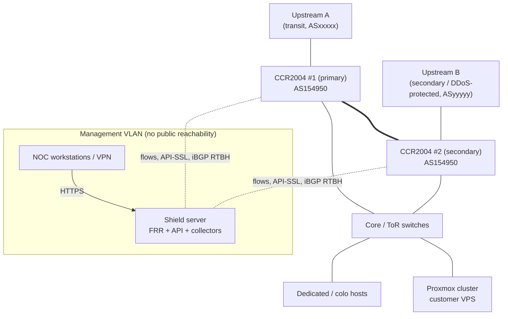

# Network Topology and BGP Design

Values below are the **initial lab examples** from the spec (AS154950, the three prefixes).
They live in `config/network.example.yaml` and in the database; nothing is hardcoded.

## 1. Physical / logical topology

## 2. Protected address space (examples)

| Prefix | Notes | Announced to | RTBH scope allowed by default |
|---|---|---|---|
| 163.5.191.0/24 | VPS | A, B | /32 only |
| 77.107.95.0/24 | Hosting | A, B | /32 only |
| 163.52.252.0/23 | Infra + VPS | A, B | /32 only |

Prefix-wide RTBH (/24 or /23) requires an explicitly authorised policy.

## 3. BGP sessions

| Session | Type | Purpose | Filters |
|---|---|---|---|
| R1 ↔ Upstream A | eBGP | Normal transit | Existing — Shield does not modify |
| R2 ↔ Upstream B | eBGP | Normal transit | Existing — Shield does not modify |
| R1 ↔ R2 | iBGP | Existing | Existing |
| Shield (FRR) → R1, R2 | iBGP, AS154950, passive-receive on routers | Signal RTBH and steering routes | Router side: accept only /32 (and policy-allowed shorter) **within protected prefixes**, tagged with Shield's internal community; reject everything else. FRR side: outbound prefix-list = protected prefixes le 32 |
| Shield (FRR) → Upstream X | Optional dedicated eBGP RTBH session (if the provider offers one) | Upstream RTBH | Provider's documented community / next-hop / prefix-length rules |

### Internal signalling community scheme (Shield-owned, configurable)

Standard communities are two 16-bit numbers, so a 4-byte AS such as 154950 cannot be the first
half (`154950:666` is invalid; Shield refuses it). These routes never leave your network
(`no-export`, iBGP only), so `65535:...` values are fine.

| Community | Meaning | Router action |
|---|---|---|
| `65535:666` | Internal blackhole | Set next-hop to blackhole (`blackhole` route type in RouterOS v7) |
| `65535:667` (example) | Upstream RTBH request | Re-advertise to upstream(s) with that upstream's RTBH community, `no-export` |
| `65535:700`/`701` (example) | Steer via Upstream A/B | Prepend/withhold toward the other upstream per steering policy |

`65535:666` (RFC 7999 BLACKHOLE) is used **only** if the specific upstream documents support for it.

## 4. Upstream RTBH policy — what must be collected from each provider

Shield refuses to enable RTBH for an upstream until all of these are configured:

1. Upstream ASN and RTBH-capable neighbour address (main session or dedicated).
2. Blackhole community value(s) (e.g. `ASN:666`, RFC 7999, or provider-specific).
3. Required next-hop, if any (e.g. a discard next-hop like 192.0.2.1).
4. Accepted prefix-length range (commonly /32 only for IPv4; some accept /24–/32).
5. Whether the prefix must also be covered by a valid IRR route object / RPKI ROA.
6. Max-prefix limit on the session (Shield's max-route limit must be lower).
7. Whether `no-export` is required/added.

## 5. Inbound steering reality check

Changing local routes only affects **outbound** traffic. Inbound path selection is controlled
by what we announce: withdrawing a more-specific from one upstream, AS-path prepending, or
provider "do not announce to X" communities. Shield's steering module (Phase 9) only uses
these mechanisms, validates that the covering aggregate remains announced to at least one
upstream, and refuses any change that would leave a protected prefix unannounced.

## 6. Flow export

- RouterOS v7 Traffic-Flow: IPFIX (v10) or NetFlow v9 to `shield:2055` (UDP), from both routers,
  on upstream-facing interfaces, with `packet-sampling=yes` where supported (sampling rate is
  recorded per exporter in Shield; flows without a known rate are flagged `estimated`).
- sFlow from switches that support it to `shield:6343`.
